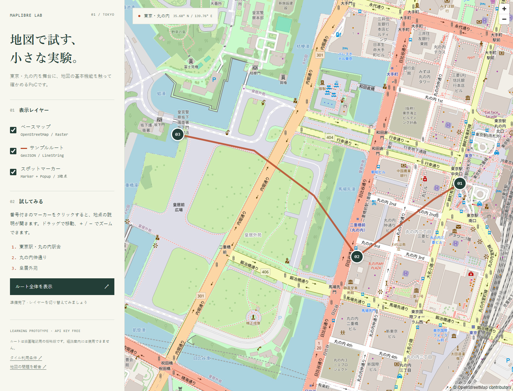
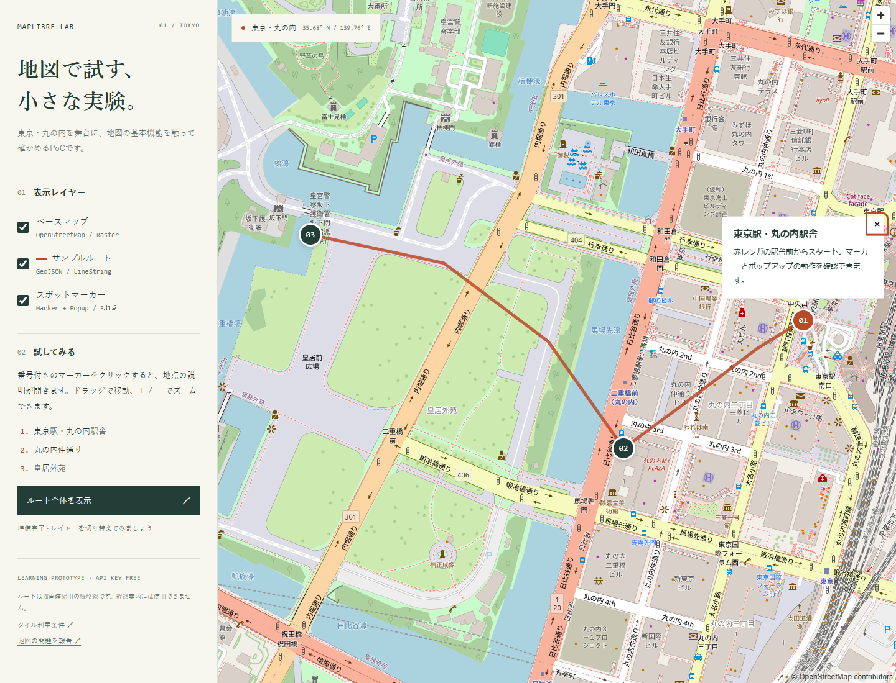
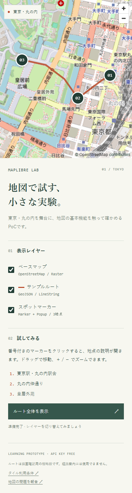

# MapLibre GL JS PoC

**DEMマルチプロバイダー対応（2026-10-17）**: GSI / Mapterhornを切り替えて、地点標高・2点勾配・ルートを比較できます。
説明には [図解・デモ用資料（HTML）](docs/dem-explainer.html) と [実装の読み方（Markdown）](docs/dem-explainer.md) を使ってください。
詳細な [検証結果](docs/dem-validation.md)、[PR 3の調査・実装計画](docs/dem-pr3-plan.md) もあります。

Vite + TypeScriptで、MapLibre GL JSの基本操作を学ぶための技術検証環境です。本番アプリや経路案内サービスではありません。APIキー、バックエンド、環境変数は不要です。地図タイルの取得にはインターネット接続が必要です。

## スクリーンショット

実際のOpenStreetMapタイルで撮影した画面です。撮影条件は [docs/screenshots/README.md](docs/screenshots/README.md) に記載しています。

### PC表示



### マーカーのポップアップ



### スマホ幅の表示

ブラウザー幅390pxでの表示です（モバイル実機ではありません）。



## セットアップ・起動

Node.js **22.12以上（推奨: 24 LTS）** と npm を使用します。

```sh
npm ci
npm run dev
```

ターミナルに表示されるURL（通常 `http://127.0.0.1:5173/poc-maplibre/`）を開いてください。WebGL対応ブラウザーが必要です。

```sh
npm run build    # TypeScriptの型チェック + dist/へのビルド
npm test         # Vitestによる純粋関数のテスト（距離・勾配・獲得標高・DEMデコードなど）
npm run preview  # ビルドした成果物を確認（通常 http://127.0.0.1:4173/poc-maplibre/）
```

`preview` は検証用サーバーです。本番配信には使用しません。

## GitHub Pagesへの公開

公開URL: https://norinori1.github.io/poc-maplibre/

リポジトリの **Settings → Pages → Build and deployment → Source** を **GitHub Actions** に設定してください。
GitHub Actionsを有効にし、公式の `actions/*` が許可されている必要があります。
`github-pages` environmentに保護ルールを設ける場合は、`main` からのデプロイを許可してください。

`.github/workflows/deploy.yml` は、`main` へのpush（PRのマージを含む）でテスト・型チェック・ビルドを行い、`dist/` を公開します。
手動で再デプロイする場合は **Actions → Deploy to GitHub Pages → Run workflow** で `main` を選択してください。
他のブランチからの手動実行はスキップされます。Node.js 24と既存のnpmロックファイルを使用し、npmキャッシュでインストール時間を抑えます。
APIキーやSecretsの設定は不要です。

`vite.config.ts` の `base: '/poc-maplibre/'` により、CSS・JavaScript・MapLibre WorkerのURLに公開パスを付けます。
GeoJSONは既存実装のままJavaScriptに同梱され、OSMタイルはHTTPSで取得します。

公開確認は、Actionsのbuild/deployが成功した後に公開URLを開き、地図・3つのマーカー・ポップアップ・レイヤー切替・範囲リセットを試してください。
ブラウザーのNetworkで `/poc-maplibre/assets/` 配下のJS・CSS・WorkerがHTTP 200で読み込まれ、Consoleにエラーがないことも確認します。
ローカルでは `npm ci` → `npm run build` → `npm run preview` の順で、同じ公開パスの動作を確認できます。

## 使用技術・ファイル構成

- Vite: 開発サーバーと静的ファイルのビルド
- TypeScript: strict型チェック
- MapLibre GL JS: WebGLによる地図表示、マーカー、ポップアップ、描画レイヤー
- GeoJSON: `[経度, 緯度]` の座標列を持つ `LineString`
- OpenStreetMap: APIキー不要の標準ラスタータイル
- 国土地理院 標高タイル: APIキー不要のDEM（標高・勾配の推定に使用）
- Mapterhorn: APIキー不要の512px WebP / Terrarium DEM（GSIとの比較用）
- Vitest: 純粋関数の単体テスト

```text
index.html                操作パネルと地図のHTML
src/main.ts               機能別コメント付きのMapLibre初期化・イベント処理
src/style.css             レイアウトとマーカー・標高パネルのスタイル
src/data/spots.ts         3地点の座標・説明文
src/data/route.geojson    描画確認用の概略ルート（丸の内・平地）
src/data/route-hill.geojson 上り勾配の確認用ルート（九段坂）
src/elevation.ts          標高・勾配のUI操作（クリック標高、2点勾配、ルートのプロファイル）
src/dem/config.ts         DEM供給元・ズーム・帰属表示の設定（供給元の変更はここ）
src/dem/decode.ts         GSI PNG / TerrariumのRGB → 標高(m)
src/dem/tiles.ts          緯度経度 → タイル・画素座標
src/dem/loader.ts         タイル取得・デコード・キャッシュ（ブラウザー依存）
src/dem/sampler.ts        標高サンプラー（双線形補間、5m→10mのフォールバック）
src/geo/math.ts           球面距離・平均勾配
src/route/profile.ts      ルートの等間隔サンプリング・獲得標高・区間勾配
src/ui/                   表示整形とSVGグラフ
```

## 実装機能・試し方

| 機能 | MapLibre API | 試し方 |
| --- | --- | --- |
| 地図表示 | `Map`、raster source/layer、`NavigationControl` | 東京駅周辺が表示される。ドラッグ、ホイール、＋ / − で移動・ズーム |
| マーカー配置 | `Marker` | 番号付きの3地点を表示。`spots.ts` の座標変更で位置を試せる |
| ポップアップ | `Popup.setDOMContent`、`Marker.setPopup` | マーカーをクリック、またはTabで選択してEnter / Space。閉じるボタンで終了 |
| GeoJSONルート | `addSource`、`addLayer(type: 'line')` | 茶色の折れ線を確認。`route.geojson` の座標を編集して再表示 |
| レイヤー切替 | `setLayoutProperty(..., 'visibility', ...)` | ベースマップとルートのチェックを外して非表示、戻して再表示 |
| マーカー切替 | `Marker.remove` / `addTo` | マーカーのチェックを切り替える。非表示時はポップアップも閉じる |
| 表示範囲リセット | `LngLatBounds`、`fitBounds` | 「ルート全体を表示」でルート全体が見える範囲に戻る |

DOMマーカーはスタイルレイヤーではないため、切替方法を分けています。ソースと線レイヤーは `load` 後に追加し、操作パネルもそこで有効化します。タイル読み込み失敗とWebGL初期化失敗は画面に通知します。

MapLibre v6はWorkerを別ファイルで配信します。`main.ts` で `?worker&url` と `setWorkerUrl` を使用し、Workerの依存ファイルもViteで同梱します（[公式導入ガイド](https://maplibre.org/maplibre-gl-js/docs/)）。`?url` だけにするとビルド後にWorkerの依存解決が失敗するため、開発サーバーだけでなく `build` + `preview` でも検証してください。

ルートは手書きの描画サンプルで、道路への追従・通行可否・距離の正確性を保証しません。経路探索APIや現在位置の取得は実装していません。

## 標高・勾配の推定（DEM連携）

自転車向けに「地点の標高」「2点間の勾配」「ルートの起伏」を表示できるかを確かめる機能です。操作パネルの **03 標高・勾配** から使います。数値はすべて**推定値**で、経路案内には使用できません。

### 操作方法

| 操作 | 手順 |
| --- | --- |
| 標高を調べる | 「標高を調べる」を選び、地図をクリック。緯度・経度と推定標高を表示 |
| 2点の勾配 | 「2点の勾配」を選び、始点・終点を順にクリック。高低差(終点−始点、+が上り)・水平距離・平均勾配を表示。3回目のクリックで選び直し |
| ルートの標高プロファイル | 対象ルートを選び「ルートの標高プロファイルを作成」。累積距離×標高のグラフ、総距離、獲得標高、下降量、最低/最高、全体と50m/100m区間の勾配を表示 |
| 操作なし | 既定。マーカーのポップアップを優先し、地図クリックは何もしない |

モードが有効でも、マーカー・ポップアップ上のクリックは計測に使いません。標高が取得できない場合（ロード中、範囲外、欠測、通信エラー）は理由つきで `取得できません` と表示し、0 m とは扱いません。

プロファイルの検証には、平地の「丸の内のサンプルルート」に加え、上り坂を含む **「九段坂の検証用ルート」**（`src/data/route-hill.geojson`、約390m）を用意しています。平地では勾配がほぼ0になるため、勾配の検証は坂のあるルートで行ってください。

### GSIの出典・利用条件

- 出典: **国土地理院 標高タイル（PNG標高タイル）**。画面のフッターと各結果に `標高: 国土地理院 標高タイル` を表示します。利用条件は[国土地理院 地理院タイル一覧](https://maps.gsi.go.jp/development/ichiran.html)・[標高タイルの仕様](https://maps.gsi.go.jp/development/demtile.html)を確認してください。
- URL: 5mメッシュ `https://cyberjapandata.gsi.go.jp/xyz/dem5a_png/15/{x}/{y}.png`（提供範囲が限られる）を優先し、提供範囲外（404）または欠測のときは 10mメッシュ `.../dem_png/14/{x}/{y}.png` に切り替えます。設定は `src/dem/config.ts` だけです。
- GSIはAPIキー不要、CORS許可（`Access-Control-Allow-Origin: *`）。対象は日本国内で、タイル・画素のない地点は取得不可です。Mapterhornは下記の別Providerです。
- 取得するのはクリック地点・ルート上の点が属するタイルだけです。プリフェッチや一括取得はせず、同じタイルはメモリにキャッシュします。無制限・可用性保証付きのサービスではないため、利用規模を広げる前に最新の利用条件を確認してください。

### 方式の選定理由（`raster-dem` / `queryTerrainElevation` を使わなかった理由）

MapLibreの `raster-dem` は `encoding: 'custom'`（`redFactor: 655.36`、`greenFactor: 2.56`、`blueFactor: 0.01`）で国土地理院のタイルを読めます。一方で、

- 欠測値（RGB = 128,0,0）が約83886mとして復号され、`setTerrain` で海側などに突起が出る
- `queryTerrainElevation` は描画に使われたタイルの読み込み状態に依存し、座標を渡しても常に値が返るとは限らない
- 地図の描画設定（既存のベースマップ・マーカー・ルート）に影響を与えうる

ため、このPoCでは**必要なタイルだけを自前で取得して復号するサンプラー**（`src/dem/`）を使い、`setTerrain` は使用していません。欠測は `null` として扱い、5m→10mのフォールバックを明示できます。3D地形表示や陰影起伏には `raster-dem` ソースが適しており、今後の候補です。

### 計算方法

- 水平距離は緯度経度から求める大円距離（haversine）です。ピクセル距離ではありません。
- 標高は画素中心を基準にした双線形補間です。周囲4画素のいずれかが欠測のときは、中心画素の値にフォールバックします。
- 平均勾配 = 高低差 / 水平距離 × 100。水平距離が5m未満（同一地点を含む）のときは計算しません。+は上り、−は下りです。
- ルートは頂点だけではなく、線に沿って5m / 10m / 20m間隔（既定20m、最大400点）で標高を取得します。上限で間隔を広げた場合は実間隔も表示します。
- 獲得標高は、直前の基準点から1m以上変化した分だけを上昇量・下降量に加えます。DEMの細かな揺れで過大にならないための閾値で、基準値は `src/route/profile.ts` の `MIN_RISE_M` です。
- 50m / 100m区間勾配は、各有効サンプルを始点として同じ連続区間内で終点標高を線形補間して計算します。区間に満たない末尾は除きます。
- 欠測で連続区間を分割し、獲得標高・下降量・区間勾配・平滑化は欠測をまたぎません。全体平均勾配は全点有効なときのみ計算します。

### 精度の制約（必ずお読みください）

- DEMが表すのは原則として**地表面**です。橋・高架・トンネル・立体交差では、道路の実際の高さや勾配と一致しないことがあります。
- 5m/10mの格子と補間で平滑化されるため、短い急坂や段差は実際より緩く出ます。逆に、メッシュの種類が変わる地点（5m→10m）で標高に段差が出て、区間勾配が実際より急に見えることがあります。九段坂の検証用ルートの終盤で確認しました。
- サンプルルートは手書きの概略線で、道路への追従・通行可否・距離の正確性を保証しません。**道路の瞬間勾配ではありません。**
- DEMには欠測・測量年・高さ基準の違いがあります。標高が取得できない点はグラフを途切れさせ、欠測数・率と通信等エラー点数を表示します。

### PoCとして確認できたこと

- キー不要・静的ホスティング（GitHub Pages）だけで、クリック標高・2点間勾配・ルートの標高プロファイルを実現できる
- 地理院標高タイルは日本国内でCORSを許可しており、ブラウザーから直接取得・復号できる
- 純粋関数（復号・距離・勾配・獲得標高・サンプリング）を分離すれば、DOM・地図なしでテストできる

確認できていないこと: 実機モバイルでの操作感・性能、長距離ルート（数十km）での取得時間、海外・5m提供範囲外での精度、GPS現在位置・「この先の坂」予告（今回の対象外）。

## 地図タイルの利用条件

[OSMF公式タイル利用ポリシー](https://operations.osmfoundation.org/policies/tiles/) と [OSM著作権・ライセンス](https://www.openstreetmap.org/copyright) を確認してください。

- 地図右下の `© OpenStreetMap contributors` を常時表示します。ベースマップを非表示にしても帰属表示は隠しません。
- `https://tile.openstreetmap.org/{z}/{x}/{y}.png` を使用し、OSMタイルの最大ズームを19に制限しています。
- ブラウザー標準のUser-Agent、Referer、HTTPキャッシュを使用します。Refererを削除したり、キャッシュを強制無効化したりしないでください。
- 大量ダウンロード、事前取得、オフライン用保存は禁止です。自動テストで大量のパン・ズームや連続再読み込みをしないでください。
- APIキー不要でも無制限・可用性保証付きのサービスではありません。公開・利用規模拡大前に利用条件を再確認し、用途に適した配信事業者または自前タイルへ切り替えてください。URLと帰属表示は `src/main.ts` の `osm` sourceにあります。
- タイル提供先へIPアドレスやRefererなどが送信されます。個人情報・機密情報を地図データに入れないでください。

## 今後検証すべきこと

- 実機のモバイルSafari / Chrome、タッチ操作、低性能GPU、WebGL無効時の表示
- 大量の地点でDOM MarkerとGeoJSON circle/symbolレイヤーを比較、クラスタリング
- GeoJSONの差し替え（`setData`）、大容量データ、座標・スキーマの検証
- ベクトルタイル、スタイル切替、地形・3D、配信事業者ごとの利用条件
- 通信断・タイル制限時の再試行方針、アクセシビリティ、CSPとWorker設定
- 本番配信先でのキャッシュ・Referer・帰属表示、依存ライブラリのライセンス確認

このPoCでは外部APIによる経路探索、認証、永続化、オフライン対応は対象外です。

## 実装時の検証結果（2026-10-13）

- Windows / Node.js 24.15.0: `npm ci`、`npm run build`（strict型チェック含む）
- Chromium / Playwright: ビルド成果物を `preview` で表示し、OSMタイルのHTTP 200と地図・ルート描画を確認
- ローカル代替タイルによる操作確認: 3マーカー、クリックとキーボードでのポップアップ、マーカー非表示時のポップアップ終了と再表示後のキーボード操作、ベースマップ・ルートの表示切替、帰属表示の維持、範囲リセット
- ルート表示切替前後の画像差分と目視確認、390px幅の横はみ出し確認、タイル通信失敗時の通知
- 開発サーバーでもスマホ幅の全マーカー表示、Enter / Spaceによる操作、ポップアップの閉じるボタンを確認。WebGL無効時のエラー通知と操作パネルの無効化も確認
- `npm audit`: 脆弱性報告0件（実行時点）

MapLibre本体を含むJSは約1.06 MB（gzip約288 KB）、Workerは約508 KBです。Viteの500 KB超チャンク警告は残しています。サイズ最適化は今後の検証対象です。上記ブラウザー確認はソフトウェアWebGLを使用しており、実機GPU・Safari・Firefox・本番配信先の確認は未実施です。

## 標高・勾配機能の検証結果（2026-10-13）

- Windows / Node.js 24: `npm ci`、`npm test`（Vitest・6ファイル42テスト）、`npm run build`（strict型チェック含む）
- Chrome（`npm run build` + `npm run preview`、`/poc-maplibre/`）で実操作を確認
  - 丸の内でのクリック標高 3.3 m（5mメッシュ）。国土地理院の標高API（同地点 3.3 m）と一致
  - 九段坂ルート（387m）のプロファイル: 最低4.5m〜最高22.0m、獲得標高21.9m、全体の平均勾配 +4.5%（上り）
  - 2点の勾配（丸の内・約310m）: 高低差 −1.0m、勾配 −0.3%。同一地点のクリックは `距離が5m未満のため計算しません`
  - マーカーのクリックはモード有効中でもポップアップを開き、計測の選択点は変わらない
  - 標高タイルの取得失敗を模擬（`fetch` を拒否）したときは `取得できません: 通信エラー` を表示し、復旧後の同地点クリックで取得できる
  - 幅375px（390pxのiframe）で横はみ出しなし、プロファイルのグラフと数値が読める
- 純粋関数のテスト: RGB復号（欠測・負標高）、距離・勾配（符号・ゼロ距離・極短距離）、サンプリング（空・1点・不正座標）、獲得標高の閾値、欠測点の集計、サンプラーの5m→10mフォールバック・範囲外・欠測・通信エラー
- 未確認: GitHub Pages 上での表示（マージ後のデプロイで確認）、海上など範囲外地点の実クリック（単体テストと404応答の確認のみ）、実機モバイル、他ブラウザー

## DEM供給元の切替・比較（2026-10-17）

| Provider | 配信と取得レベル | 原資料・利用条件 |
| --- | --- | --- |
| GSI（既定・比較基準） | 256px PNG、DEM5A/z15→DEM/z14。404・欠測だけ低解像度へ進む | [国土地理院タイル一覧](https://maps.gsi.go.jp/development/ichiran.html)、[コンテンツ利用規約](https://www.gsi.go.jp/kikakuchousei/kikakuchousei40182.html)。地理院タイルを加工した推定値として出典を表示 |
| Mapterhorn | 512px lossless WebP / Terrarium、z16固定。`https://tiles.mapterhorn.com/{z}/{x}/{y}.webp` | [配信仕様](https://mapterhorn.com/data-access/)、[帰属・各原資料の条件](https://mapterhorn.com/attribution/)。コードのBSD-3とデータの条件は別。日本向けには[GSI由来1m/5m/10m等](https://source.coop/smartmaps/japan-geotiff-dem/README.md)を含む |

Mapterhornを使っても「GSI由来の原資料を使わない」とは限りません。再配布や自前ホストを行う場合は原資料ごとの条件・測量法上の扱いを別途確認してください。
今回は外部タイルを直接取得するPoCで、原データやタイルの再配布・オフライン保存は行いません。公開サーバーに無制限の可用性保証があるとは扱いません。

操作:

1. 「DEM供給元」でGSIまたはMapterhornを選ぶ。地点標高・2点勾配・ルート共通で適用され、選択済み地点・2点・表示中プロファイルは再計測される。
2. ルートと5m/10m/20m間隔、任意の30m移動平均を選ぶ。既定はGSI・20m・生データ。
3. 通常のプロファイルボタンは選択中Providerのみ取得する。「両DEMを同じ条件で比較」は座標を一度だけ生成し、両Providerを順番に計測する。
4. 茶/青のグラフ、指標表、「各サンプルの標高・差・50m/100m区間勾配」を確認する。標高差はMapterhorn−GSI。
5. 比較中・比較後は両DEMの帰属を維持する。Mapterhornの取得失敗時にGSIへ自動切替しない。

取得・復号:

- ローダーで画像寸法を確認し、色空間変換・拡縮をせずRGBを読み取る。完全不透明な画素だけを復号し、透明・半透明は欠測として扱う。
- Terrariumは`R*256 + G + B/256 - 32768`。GSI固有の欠測RGB値はGSI decoderだけで処理する。
- 取得中Promiseとキャッシュを共通化。Provider・レベル・URL・サイズ・エンコード・座標で識別し、全体32MiB/128件のLRU。404は60秒保持、通信・HTTP・復号エラーは保持しない。同時取得・復号は6件、通信タイムアウトは20秒。
- 消費側の中断は共有通信を他の利用者のため保持し、待機と次バッチを停止する。地点は世代番号、プロファイルはAbortControllerと処理同一性で古い表示更新を防ぐ。
- **Mapterhornの欠測制約**: [生成処理](https://github.com/mapterhorn/mapterhorn/blob/775663e9ca58c7fe741dbd53fbe4461cb73a9bb9/pipelines/aggregation_tile.py)には残存欠測を0m化する処理がある。透明画素などの検出可能な欠測は除外するが、配信前の補完・0m化は識別できない。欠測0点を原資料の完全性と解釈しない。
- ズーム、出力画素間隔、元DEMの空間解像度、復号の数値分解能、高さの測定精度は別のもの。5m間隔で出力しても測量精度は向上しない。

実測した生データの例（Chrome 155 / Windows、ローカルproduction preview、20m間隔）:

| ルート | 獲得標高 GSI / Mapterhorn | 下降量 GSI / Mapterhorn | 全体平均勾配 GSI / Mapterhorn |
| --- | --- | --- | --- |
| 丸の内 約964m | 8.7m / 7.3m | 3.7m / 5.3m | +0.5% / +0.2% |
| 九段坂 約387m | 21.9m / 25.5m | 4.7m / 13.8m | +4.5% / +3.0% |

欠測はこの比較では両方0点。九段坂5m間隔では獲得標高29.0m / 26.5mに変わった。間隔・ノイズ・接合部などの影響を受け、差や一致だけで精度は判定できない。
アプリキャッシュ空の取得は丸の内3/4件、本文160.6/228.9KiB、九段坂2/2件、112.6/142.4KiB。HTTPキャッシュは有効。
処理時間は[全12条件の実測記録](docs/dem-validation.md)を参照。本文サイズは実ネットワーク転送量ではなく、配列容量はブラウザ全体のメモリではない。

検証: `npm ci`、60単体テスト、型チェック・ビルド、実ブラウザで両DEMの地点・2点・ルート、RGB保持、切替競合、模擬404/通信断、375px幅、`/poc-maplibre/`配下のJS/CSS/Worker読込を確認。
**未検証**: 新機能を公開GitHub Pagesへデプロイした状態、実機モバイル、Safari/Firefox、正解標高との精度比較、実回線の転送量・ブラウザ全体のメモリ。

PR 1は共通基盤、PR 2はMapterhornと比較UI。PR 3の自治体DEMは[調査・実装計画](docs/dem-pr3-plan.md)までとし、実装を含めない。
