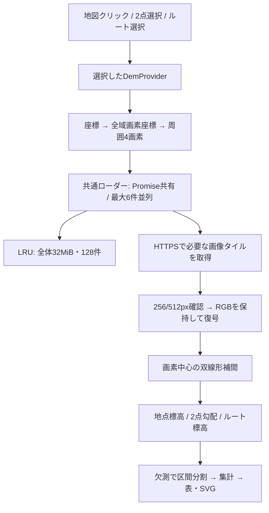

# DEM比較PoC — 実装の読み方とデモ台本

対象: 機能を説明する人、コードを引き継ぐ開発者。2026-10-17。

## 何を変えたか

地図の表示は従来どおりMapLibreとOpenStreetMap。標高はMapLibreの3D地形機能を使わず、
別のサンプラーが画像タイルを直接取得する。以前はGSI固定だった設定をProviderとして分離し、
同じ取得・補間・集計処理へGSIとMapterhornのどちらも渡せるようにした。

## 各部分の責任

| 読む場所 | 分かること |
| --- | --- |
| `src/dem/config.ts` | ProviderのID、出典・条件・帰属、提供範囲、URL、ズーム、画素数、復号方式、フォールバック |
| `src/dem/tiles.ts` | 緯度経度と画素・タイル座標の変換。タイルサイズを引数として受け取る |
| `src/dem/loader.ts` | 必要なタイルの取得、画像寸法確認、復号、Promise共有、LRU、性能カウンター |
| `src/dem/decode.ts` | GSIとTerrariumのRGBから高さへの式。透明画素はローダー側で除く |
| `src/dem/sampler.ts` | 隣接タイルをまたぐ4画素の補間、欠測・404・エラーの分岐 |
| `src/route/profile.ts` | 同間隔の最大400点、欠測で分割、1m閾値の上下降、50/100m窓、30m移動平均 |
| `src/route/compare.ts` | 座標を一度だけ生成し、同じ点で両Providerを順に計測 |
| `src/elevation.ts` | 選択と再計測、古い非同期結果の破棄、帰属表示 |
| `src/ui/comparison.ts` / `chart.ts` | 比較表と共通軸のグラフ。DOMの値はtextContentで入れる |

## Providerの違い

| | GSI | Mapterhorn |
| --- | --- | --- |
| 取得 | PNG、256px、z15→z14 | lossless WebP、512px、z16固定 |
| 原資料 | 国土地理院DEM5A / DEM10B | 世界各地の公開DEM。日本はGSI由来も含む |
| 復号 | 24bit符号付き値 × 0.01m | `R*256 + G + B/256 - 32768` |
| 取得不能時 | 404・欠測のみ5m→10m | GSIにも別ズームにも自動切替しない |
| 欠測の限界 | GSIのRGB欠測値と透明画素を除く | 透明画素を除く。配信前の補完・0m置換は識別不能 |

「GSIサーバーへのアクセスを避ける」はMapterhornで実現できる。
「GSI由来の原資料を避ける」は別の条件であり、今回のMapterhorn追加では満たしたと扱わない。

## 競合とキャンセルをどう扱うか

地点・2点計測は世代番号を取得時に記録し、新しいクリック・モード変更・Provider変更後は古い結果を表示しない。
ルートはAbortControllerと処理の同一性を併用し、結果だけでなく進捗とエラーも古い処理から更新させない。
中断した利用者の待機はすぐ終了するが、共有中のタイル通信は他の利用者のため完了させる。
通信には20秒のタイムアウトがあり、タイル取得・復号の最大並列数は6件。

## 比較の読み方

- 生データは双線形補間後の標高。画像の生RGBや未加工の原測量点という意味ではない。
- 30m移動平均は各点から前後15mの同じ有効区間内の標高を平均する。欠測は埋めない。端では窓を切り詰める。
- 20m間隔では窓内に自分だけが入る点が多く、平滑化の効果が小さい。端の短い区間では隣の点も入ることがある。
- 獲得標高は1mの変化閾値を適用した推定値。間隔や平滑化で値が変わる。
- 50/100m窓の終点は同じ連続区間内の線形補間。欠測のあるルート全体の平均勾配は表示しない。
- 欠測率は配信データから検出できた欠測の割合。Mapterhornの元データに欠測がないことの証明ではない。
- キャッシュヒットは画素読み取り単位の参照数であり、ユニークなタイル枚数ではない。
- 処理時間は標高取得から集計まで。画像本文サイズはHTTPキャッシュを含み、実回線の通信量と異なる。

## 5分デモ

1. `npm ci`、`npm run build`、`npm run preview`で`/poc-maplibre/`を開く。
2. GSIで「標高を調べる」を選び地図をクリック。Mapterhornへ切り替え、同じ地点を再計測する。
3. 「2点の勾配」で離れた2点を選び、供給元を切り替える。選択座標が保持されることを示す。
4. 九段坂、20m、生データで「両DEMを同じ条件で比較」。表と各サンプルの標高差を開く。
5. 5m、30m移動平均を選び、再度比較ボタンを押す。実線と破線、獲得標高の変化を示す。
6. 同条件で再実行し、新規取得が0、取得本文サイズが0になるアプリキャッシュの効果を示す。
7. 「原資料が共通の可能性」「地表面と道路高の違い」「欠測の検出限界」を説明する。

## 今回の実測例

九段坂、約387m、20m間隔、生データでは獲得標高はGSI **21.9m**、Mapterhorn **25.5m**。
全体平均勾配は **+4.5% / +3.0%**。5m間隔では獲得標高が **29.0m / 26.5m** になった。
この差だけでどちらが正しいとは判断できない。橋、段差、DEM接合部、補間、測量年などを別途確認する。
詳細条件と全比較は[検証記録](dem-validation.md)を参照。

## PRの分割

- PR 1: GSI互換のProvider共通基盤、キャッシュ・取得制御、50単体テスト。
- PR 2: Mapterhorn、選択UI、比較・平滑化、欠測集計修正、60単体テストとブラウザ検証。
- PR 3: 自治体由来データの調査計画のみ。大規模変換・配信やProvider追加は未実装。

公開GitHub Pages、実機モバイル、Safari/Firefox、精度の正解データとの比較は今回未検証。
